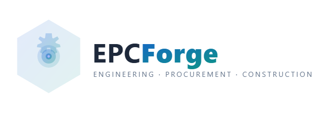
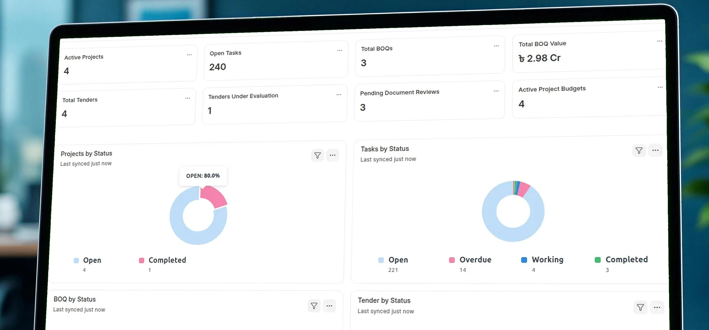
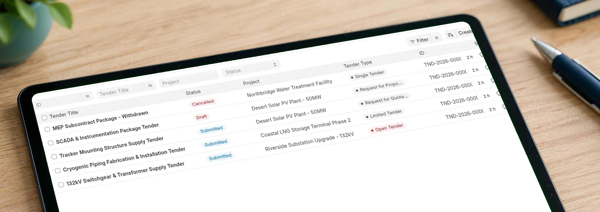

<p align="center">
  
</p>

<h1 align="center">EPCForge for ERPNext</h1>

<p align="center">
  <strong>Engineering, Procurement & Construction Management for Frappe / ERPNext v16</strong>
</p>

<p align="center">
  <a href="https://github.com/invento-software-limited/epcforge/blob/version-16/license.txt"></a>
  <a href="https://invento-software-limited.github.io/epcforge/"></a>
  <a href="https://frappe.io"></a>
  <a href="https://erpnext.com"></a>
</p>

<p align="center">
  <a href="https://cloud.frappe.io/marketplace/apps/epcforge"></a>
  <a href="https://invento.com.bd/epcforge-erpnext-boq-project-control/"></a>
  <a href="https://invento.com.bd/free-consultation/"></a>
</p>

---

## 📦 About EPCForge

**EPCForge connects construction BOQs to project tasks, material requests and milestone invoice preparation in ERPNext v16.** It is built for EPC firms, contractors, estimators and project teams.

ERPNext supplies purchasing, stock, accounting, Projects and Tasks. EPCForge adds BOQ scope, project budget cost heads, tender records and an engineering document register around that foundation.

---

## Product views

### Project activity and status

Projects, Tasks, BOQs and tenders in the published EPCForge dashboard.



### Tender packages in context

Review tender status alongside the related project and tender type.



## ✨ Detailed Features

### 🎯 BOQ, project work and materials
- **BOQ structure**: Group quantities, rates and estimated costs; link scope to project Tasks.
- **Material Requests**: Prepare requests from eligible Material rows linked to stock Items, then continue through ERPNext purchasing.
- **Milestone billing**: Use billing-milestone Tasks in the BOQ payment schedule to prepare a draft Sales Invoice for a selected milestone.
- **Budget setup**: Submitting a BOQ can create a Project Budget record. Configure and review its cost-head allocations separately.

### 💾 Project budgets and recorded costs
- **Budget allocations**: Organize planned amounts by project cost head.
- **Commitments**: View totals from submitted Purchase Orders assigned to the project and cost head.
- **Recorded costs**: Review submitted Purchase Invoice totals and approved Timesheet costs.

**Review before relying on balances:** Purchase Orders remain in commitment totals after invoicing, so order and invoice values can overlap. Reconcile the underlying records; these views do not establish cash availability or project margin, or automatically prevent overspending.

### 🔌 Tender and bidder management
- **Tender packages**: Record tender status, project, type and key dates.
- **Bidder evaluation**: Keep supplier bids, commercial scores and evaluation notes together.
- **Award records**: Record decisions; create and approve Purchase Orders through the appropriate purchasing process.

### ⚡ Engineering document register
- **Document records**: Organize drawings, specifications, RFIs, submittals and NCRs.
- **Revisions and reviews**: Record revision identifiers and review statuses.
- **Issue procedures**: Configure responsibilities and approvals. Revision records alone do not prevent use of an obsolete drawing.

### 📊 Reports and dashboards
- **BOQ and tender summaries**: Review scope, amounts and tender status.
- **Project views**: Inspect project activity, budget allocations and recorded costs, with the reconciliation boundaries above.

---

## 💻 Prerequisites & Compatibility

- **Frappe Framework**: `v16.0.0` or higher (`>=16.0.0,<17.0.0`)
- **ERPNext**: `v16.0.0` or higher (`>=16.0.0,<17.0.0`)
- **Release status**: Beta; evaluate on a test site before production.
- **Runtime**: Use the Python, Node and database versions required by your Frappe v16 installation. The app package declares Python `>=3.10`; that is not the complete Frappe environment requirement.

---

## ⚙️ Installation

**Frappe Cloud:** [Open the free app listing](https://cloud.frappe.io/marketplace/apps/epcforge) and check installation requirements for your site.

**Self-hosted:** Back up your site and test the version-16 branch before installing on your Frappe bench:

```bash
# Navigate to your bench directory
cd ~/frappe-bench

# Fetch the repository
bench get-app --branch version-16 https://github.com/invento-software-limited/epcforge

# Install on your target site
bench --site [your-site-name] install-app epcforge

# Build assets & run migrations
bench build
bench --site [your-site-name] migrate
```

---

## 🚀 Quick Start & Usage Workflow

1. **Prepare the project**: Set up the Company, project, Items, accounts and permissions in ERPNext.
2. **Build the BOQ**: Add groups and line items, quantities, rates and Task links. Review before submission.
3. **Allocate the budget**: Open the linked Project Budget and review cost-head allocations.
4. **Prepare materials and billing**: Use eligible material rows for Material Requests and the BOQ milestone schedule for draft invoice preparation. Review each resulting transaction.
5. **Keep supporting records**: Record tender evaluations, awards, document revisions and review decisions.

See the [illustrated EPCForge workflow](https://invento.com.bd/epcforge-erpnext-boq-project-control/) for fit, configuration and limitations. The MIT app is free; hosting, implementation and support services are separate.

---

## 📚 Documentation

Detailed documentation, user guide, and API reference are available on our GitHub Pages site:
👉 **[EPCForge Online Documentation Portal](https://invento-software-limited.github.io/epcforge/)**

---

## 🏢 About Publisher & Support

Developed and maintained by **Invento Software Limited**. Invento builds enterprise-grade Frappe and ERPNext applications for construction, engineering, manufacturing, and supply chain enterprises.

- 🌐 **Website**: [invento.com.bd](https://invento.com.bd)
- 📧 **Support Email**: [hello@invento.com.bd](mailto:hello@invento.com.bd)
- 🐞 **Issue Tracker**: [GitHub Issues](https://github.com/invento-software-limited/epcforge/issues)
- ⭐ **Star Us**: If you find EPCForge helpful, give us a star on GitHub!

---

## 📄 License

This repository is licensed under the [MIT License](license.txt).
